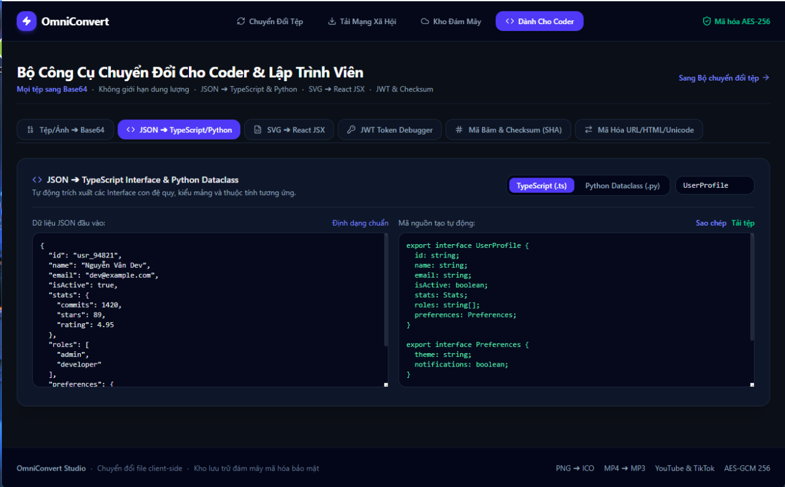

# ⚡ OmniConvert

### Một bộ công cụ gọn gàng cho mọi thứ liên quan đến tệp tin.

Chuyển đổi media, tải nội dung từ mạng xã hội, cất giữ tệp an toàn và xử lý các tác vụ lập trình — tất cả trong một giao diện desktop tối màu, dễ dùng.

<p align="center">
  
  
</p>

## ✨ Có gì bên trong?

| Công cụ | Bạn có thể làm gì |
| --- | --- |
| **Chuyển đổi tệp** | Đổi định dạng ảnh, âm thanh, video, tài liệu và dữ liệu; chuyển nhiều tệp cùng lúc. |
| **Tải mạng xã hội** | Lấy thông tin và tải video hoặc âm thanh từ các liên kết được hỗ trợ, gồm YouTube và TikTok. |
| **Kho lưu trữ** | Lưu tệp trong trình duyệt bằng IndexedDB, tìm kiếm, xem trước và xuất bản sao lưu ZIP. Có thể khóa tệp bằng PIN và mã hóa AES-GCM. |
| **Coder Studio** | Tạo Base64, chuyển JSON thành TypeScript/Python, đổi SVG sang React JSX, giải mã JWT và tính checksum. |

<p align="center">
  
  
</p>

> **Lưu ý về kho lưu trữ:** dữ liệu được lưu cục bộ trên thiết bị trong IndexedDB, không đồng bộ lên dịch vụ cloud. Mã hóa AES-GCM áp dụng cho tệp được khóa bằng PIN.

## 🚀 Bắt đầu

### Yêu cầu

- Node.js và npm
- FFmpeg cài đặt và có trong `PATH` để dùng các tính năng chuyển đổi media cần FFmpeg
- Kết nối Internet khi tạo bản desktop để tải bản phát hành chính thức của `yt-dlp`

### Chạy ở chế độ phát triển

```powershell
npm ci
npm run dev
```

Mở địa chỉ local được hiển thị trong terminal.

### Tạo bộ cài Windows

```powershell
npm ci
npm run build:desktop
```

Bộ cài NSIS được tạo trong thư mục `release/`. Lệnh build sẽ tải `yt-dlp.exe` và đóng gói cùng ứng dụng.

## 🧰 Công nghệ

React · TypeScript · Vite · Tailwind CSS · Electron · Express

## 📄 Kiểm tra mã nguồn

```powershell
npm run lint
```
